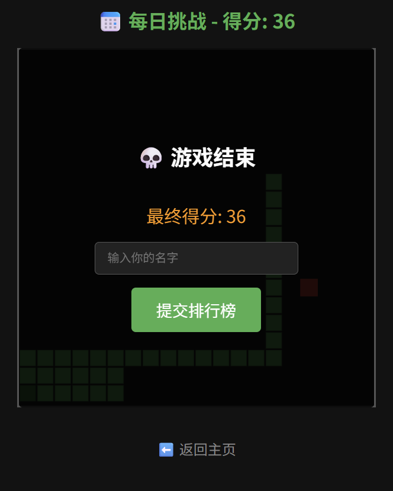

# 🎮 Snake Game Frontend (Vue 3 / Canvas)


这是一个基于 **Vue3 + Canvas** 构建的响应式贪吃蛇游戏客户端，支持 PC 键盘操作与移动端触屏滑动操作，配备完善的游戏引擎与每日挑战玩法。

## ✨ 核心特性

- **Retina 高清渲染**：Canvas 完美适配 `devicePixelRatio`，解决高分屏画面拉伸与马赛克模糊问题。
- **帧级游戏循环**：采用 `requestAnimationFrame` 替代传统 `setInterval`，实现丝滑 60 FPS 动画，并内置时间补偿算法防止定时器漂移与切后台掉帧。
- **纯函数式游戏引擎**：将渲染层（`Renderer`）与逻辑层（`SnakeEngine`）完全解耦，引擎内部极简且零 DOM 操作。
- **伪随机数（PRNG）同步**：自研 `Mulberry32` 算法，通过纯整数位运算生成随机数，完美对齐 C++ 后端的种子生成序列，实现绝对公平的“每日挑战”。
- **移动端完美适配**：响应式 Flex 布局 + 触屏滑动事件监听（`touchstart/touchend`），彻底禁用移动端滑动时的页面滚动。
- **零内存泄漏**：页面销毁（`onUnmounted`）或退出游戏时，自动清理 `requestAnimationFrame` 与所有键盘、触摸事件监听。

## 🚀 快速开始

### 安装依赖

```bash
npm install
```

### 启动开发服务器

```bash
npm run dev
```

### 生产环境构建

```bash
npm run build
# 产物将输出至 dist/ 目录，可直接托管给 Nginx 等服务器
```

## 🧠 架构设计亮点

1. **Vue Router 多页面路由**：拆分为主页（`HomeView`）、游戏页（`GameView`）与排行榜（`LeaderboardView`），通过前端路由实现无刷新切换。
2. **输入防抖与防连点**：利用 `ref` 与闭包实现 `isSubmitting` 提交防抖锁，配合 UI 按钮的 `:disabled` 属性，防止玩家狂点导致重复提交。
3. **网络健壮性**：所有 `fetch` 请求均严格校验 `HTTP Status Code`（`res.ok`），配合 `Promise.all` 处理并发拉取，避免前端解析 HTML 报错页面导致白屏。

## 🎨 预览截图


